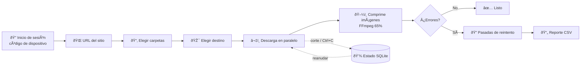

<div align="center">

# 📦 SP-Migrar

### Descarga carpetas de SharePoint Online a tu NAS desde la terminal

Eliges las carpetas y el destino, y lo dejas corriendo toda la noche: si se cae la red, el NAS o la sesión, espera a que vuelvan y continúa.


[Características](#-características) ·
[Instalación](#-instalación) ·
[Uso](#-uso) ·
[Manejo de errores](#%EF%B8%8F-manejo-de-errores) ·
[Configuración](#%EF%B8%8F-configuración) ·
[Problemas comunes](#-problemas-comunes)

</div>

---

## 👀 Así se ve

```text
==============================================================================
 ESTÁS EN:  Ventas  >  Documentos     (12 archivo(s) aquí)
==============================================================================
    1) Clientes      (18.40 GB, 1203 elementos)
    2) Facturas      (1.20 GB, 50 elementos)
    3) Proyectos     (4.77 GB, 312 elementos)

  ¿Qué quieres hacer?
    Escribe un NÚMERO        -> abrir esa carpeta y ver lo que tiene
    Escribe D y el número    -> DESCARGAR esa carpeta completa   (ej: D 3   o varias: D 1,4)
    Escribe D sola           -> DESCARGAR la carpeta donde estás ahora
    Escribe A                -> volver Atrás
    Escribe S                -> Salir sin descargar

  Opción: D 1,3
```

```text
17:25:07 INFO    OK  Clientes/2024/Contrato_ACME.pdf  [2.31 MB en 0.6s]
17:25:08 INFO    OK  Clientes/2024/Propuesta.docx  [412.20 KB en 0.3s]
17:26:07 INFO    [ESTADO] OK 1840 | omitidos 0 | errores 0 | en cola 16 | 9.71 GB a 42.30 MB/s | 4m 02s
02:13:44 WARNING Sin conexión a internet (ConnectionError). Esperando a que vuelva la red...
02:31:10 INFO    Conexión restablecida tras 17m 26s. Continuando.
```

## ✨ Características

| | |
|---|---|
| 🖥️ **100% terminal** | El inicio de sesión es con código de dispositivo de Microsoft, así que no hace falta navegador en el equipo. |
| 📂 **Eliges qué copiar** | Recorres bibliotecas y carpetas, ves su tamaño y descargas una o varias. |
| 🎯 **Eliges a dónde** | Puede ser un NAS (`\\NAS\Respaldos`), una unidad de red (`Z:\`) o un disco local. |
| 🔁 **Reanudable** | Si se corta, continúa donde quedó, incluso a mitad de un archivo grande. |
| 🛡️ **A prueba de fallos** | Aguanta caídas de red, del NAS, de la sesión, la limitación de SharePoint y el disco lleno. |
| ⚡ **Rápido** | Hace varias descargas a la vez (4 por defecto, configurable). |
| 🌙 **Desatendido** | Evita que el PC se suspenda y hace pasadas automáticas de reintento. |
| 📊 **Trazable** | Guarda un log detallado y deja un reporte CSV de errores que se abre en Excel. |
| 🗂️ **Fiel al original** | Respeta la estructura de carpetas y las fechas de modificación, y admite rutas de más de 260 caracteres. |
| 🖼️ **Comprime imágenes** | Recomprime JPG, PNG y WebP con FFmpeg al 65% de calidad mientras descarga, y también las que ya bajaste. |

## 🔄 Cómo funciona



## 📥 Instalación

### Opción A: ejecutable, sin instalar nada (recomendado)

1. Copia **`SP-Migrar.exe`** y **`ffmpeg.exe`** a una misma carpeta del equipo, por ejemplo `C:\SP-Migrar\`.
2. Haz doble clic en `SP-Migrar.exe`. Listo.

No necesita Python. `ffmpeg.exe` solo hace falta para comprimir imágenes: sin él, todo lo demás funciona igual. La configuración, la sesión, los trabajos y los logs se guardan **en la misma carpeta del `.exe`**, así que elige una carpeta donde tengas permiso de escritura (no `C:\Program Files`).

> 🛠️ Para generar el `.exe` tú mismo, ejecuta **`compilar.bat`** en un equipo con Python. El resultado queda en `dist\`. Si pusiste FFmpeg en `ffmpeg\ffmpeg.exe` (ver [Compresión de imágenes](#%EF%B8%8F-compresión-de-imágenes)), también se copia ahí.

> ⚠️ Windows SmartScreen puede advertir *"Windows protegió su PC"*, porque el ejecutable no está firmado. Pulsa **Más información → Ejecutar de todas formas**.

### Opción B: con Python

**Requisitos:** Windows 10/11, [Python 3.10+](https://www.python.org/downloads/) (marca *"Add Python to PATH"* al instalar) y una cuenta de Microsoft 365 con acceso al sitio.

```powershell
git clone https://github.com/neuzh22/gestor-sharepoint.git
cd gestor-sharepoint
pip install -r requirements.txt
```

> 💡 También puedes hacer doble clic en **`iniciar.bat`**: instala lo que falte y abre el menú.

## 🚀 Uso

### 1. Abrir el programa

Haz doble clic en **`SP-Migrar.exe`**, o con Python:

```powershell
python sp_migrar.py        # o doble clic en iniciar.bat
```

```text
==================================================
  SP-MIGRAR  ·  SharePoint -> NAS
==================================================
  1) DESCARGAR carpetas de SharePoint
  2) Continuar una descarga que se interrumpió
  3) Reintentar solo los fallidos de un trabajo
  4) Ver estado de un trabajo
  5) Comprimir imágenes ya descargadas (FFmpeg)
  6) Cerrar sesión de Microsoft
  0) Salir
```

### 2. Iniciar sesión

La primera vez te muestra un código. Abre **https://microsoft.com/devicelogin**, pégalo y entra con tu cuenta. La sesión queda guardada y se renueva sola.

### 3. Escribir la URL del sitio

```text
https://empresa.sharepoint.com/sites/Ventas
```

### 4. Elegir las carpetas

| Escribes | Qué pasa |
|:---:|---|
| `3` | Abre la carpeta 3 para ver lo que tiene |
| `D 3` | **Descarga** la carpeta 3 completa (varias: `D 1,4` o `D 2-5`) |
| `D` | **Descarga** la carpeta donde estás |
| `A` | Vuelve atrás |
| `S` | Sale sin descargar |

### 5. (Opcional) Descargar solo ciertas subcarpetas, por ejemplo el año 2026

Si tus carpetas tienen muchos niveles y solo quieres las de un nombre concreto, escríbelo cuando lo pregunte. Se buscan en **todos los niveles**:

```text
  Nombre de carpeta (Enter = descargar TODO): 2026

  Búsqueda terminada: 214 carpetas revisadas.
  Se encontraron 87 carpeta(s), 35.20 GB en total:
    - Documentos/Clientes/ACME/Camión/2026       (1.20 GB)
    - Documentos/Clientes/ACME/Contenedor/2026   (840.00 MB)
    - Documentos/Clientes/BETA/2026              (2.10 GB)
    ...
  ¿Descargar solo estas carpetas? (S/n):
```

- Se descarga cada carpeta `2026` **completa**, con sus subcarpetas, y se respeta su ruta (`Clientes\ACME\Camión\2026\...`).
- No se crean carpetas vacías de clientes que no tengan 2026, ni se bajan archivos sueltos de otros niveles.
- El nombre debe ser **exacto**, sin distinguir mayúsculas: `Notas 2026` no cuenta. Puedes poner varios (`2025, 2026`) o usar comodines (`2026*`).

### 6. Elegir el destino y confirmar

```text
  Ruta destino: \\192.168.1.50\Respaldos\SharePoint
  Espacio libre en destino: 3.20 TB  |  Tamaño a copiar: 22.37 GB
```

Lo descargado queda así:

```text
\\192.168.1.50\Respaldos\SharePoint\
└── Ventas\                ← sitio
    └── Documentos\        ← biblioteca
        ├── Clientes\
        └── Proyectos\
```

### 7. Si se interrumpe

Usa la opción **2** del menú, o ejecútalo directamente:

```powershell
SP-Migrar.exe --trabajo NOMBRE_DEL_TRABAJO
SP-Migrar.exe --trabajo NOMBRE_DEL_TRABAJO --solo-fallidos
SP-Migrar.exe --trabajo NOMBRE_DEL_TRABAJO --hilos 8
# (con Python: python sp_migrar.py --trabajo ...)
```

Lo que ya está copiado y no cambió se **omite**. Solo baja lo nuevo, lo modificado o lo que falló.

## 🛡️ Manejo de errores

| Situación | Qué hace |
|---|---|
| 🌐 Se cae internet | Pausa todo y revisa la conexión cada 5–60 s. Continúa sola cuando vuelve, sin límite de tiempo. |
| ✂️ Descarga cortada a la mitad | Reanuda desde el byte exacto donde quedó (archivo temporal `.sppart`). |
| 🐢 SharePoint limita (429/503) | Respeta el `Retry-After` y pausa todos los hilos. |
| 💥 Errores 5xx | Reintenta, esperando cada vez más entre intentos. |
| 🔑 Token vencido | Lo renueva solo. Si la sesión fue revocada, muestra un nuevo código y espera. |
| 🗄️ El NAS no responde | Pausa hasta que el destino vuelva a estar accesible. |
| 💾 Disco lleno | Avisa y reintenta cada 5 minutos. |
| ❌ Un archivo falla siempre | Lo registra y sigue con el resto. Al final hace 3 pasadas de reintento solo con los fallidos. |
| ⛔ Ctrl+C | Se detiene de forma segura y luego continúa donde quedó. |
| 🔤 Nombres inválidos en Windows | Los corrige (`a:b?.txt` → `a_b_.txt`). |
| 🖱️ Clic en la consola | Desactiva la "edición rápida", que congela el programa con un clic. |
| 😴 Suspensión del PC | La bloquea mientras copia. |

> ℹ️ Es normal que algunos documentos de Office pesen un poco distinto que en SharePoint, porque SharePoint les agrega metadatos al descargarlos. El log lo indica y no lo cuenta como error.

**Códigos de salida:** `0` todo OK · `2` quedaron errores · `130` detenido por el usuario.

## 🖼️ Compresión de imágenes

Al crear una descarga, el programa pregunta **"¿Comprimir las imágenes?"**. Si respondes que sí, cada imagen se recomprime con FFmpeg justo después de descargarla:

| Formato | Qué se hace |
|---|---|
| `.jpg` `.jpeg` `.jfif` | Se recomprime al **65% de calidad**. Suele ahorrar entre 40 y 60%. |
| `.webp` | Se recomprime al **65% de calidad**. |
| `.png` | Se optimiza **sin pérdida**, porque PNG no tiene calidad. Ahorra poco. |
| Otros (`.gif`, `.heic`, `.tif`, documentos…) | Se copian tal cual. |

```text
OK  Fotos/playa.jpg  [99.56 KB en 0.9s]  · comprimida 99.56 KB -> 42.54 KB (-58%)
```

**Reglas de seguridad:**
- Las imágenes conservan su **nombre y extensión**, así que no se rompen enlaces.
- La imagen comprimida solo reemplaza a la original si **realmente pesa menos**.
- Si FFmpeg falla con una imagen (dañada, CMYK…), **se conserva la original** y la copia sigue sin marcarse como error.
- Los WebP y PNG **animados** no se tocan, para no perder la animación.
- Las fotos giradas por EXIF (las de celular) **se guardan ya derechas**.
- Al relanzar el trabajo, las imágenes ya comprimidas **no se vuelven a descargar**.

> ⚠️ El JPEG recomprimido **pierde los metadatos EXIF** (fecha de captura, cámara, GPS). La fecha de modificación del archivo sí se conserva. Si necesitas esos datos, no actives la compresión.

**¿Ya descargaste imágenes sin comprimir?** La opción **5) Comprimir imágenes ya descargadas** del menú las comprime directamente en el destino, sin volver a conectarse a SharePoint.

**Obtener FFmpeg:** descarga *ffmpeg-release-essentials.zip* de [gyan.dev](https://www.gyan.dev/ffmpeg/builds/), saca `bin\ffmpeg.exe` y ponlo en cualquiera de estos lugares (se busca en este orden):

1. La ruta indicada en `ffmpeg_ruta` de `config.json`.
2. Junto a `SP-Migrar.exe` / `sp_migrar.py`.
3. `ffmpeg\ffmpeg.exe` o `ffmpeg\bin\ffmpeg.exe` dentro de esa carpeta.
4. Cualquier carpeta del `PATH`.

## ⚙️ Configuración

La primera vez se crea `config.json` (puedes partir de [`config.example.json`](config.example.json)). Ese archivo **no se sube a git**.

| Clave | Por defecto | Descripción |
|---|:---:|---|
| `hilos` | `4` | Descargas simultáneas. Súbelo a 6–8 si tu enlace es rápido y bájalo si aparecen muchos 429. |
| `reintentos_archivo` | `5` | Intentos por archivo dentro de una pasada. |
| `reintentos_peticion` | `8` | Reintentos por petición ante errores 5xx o de red. |
| `pasadas_reintento` | `3` | Pasadas finales solo con los fallidos. |
| `espera_entre_pasadas_seg` | `300` | Espera antes de cada pasada de reintento. |
| `timeout_lectura_seg` | `120` | Segundos sin recibir datos antes de dar la conexión por colgada. |
| `intervalo_estado_seg` | `60` | Cada cuánto imprime la línea `[ESTADO]`. |
| `incluir_carpeta_sitio` | `true` | Crea una carpeta con el nombre del sitio dentro del destino. |
| `evitar_suspension` | `true` | Impide que Windows se suspenda durante la copia. |
| `comprimir_imagenes` | `true` | Respuesta propuesta al crear una descarga. También se aplica a trabajos creados antes de esta función. |
| `calidad_imagenes` | `65` | Calidad de JPG/WebP (1–100). Menos calidad, archivos más pequeños. |
| `ffmpeg_ruta` | `""` | Ruta a `ffmpeg.exe` si no está junto al programa ni en el `PATH`. |
| `tenant` · `client_id` · `client_secret` | — | Autenticación (ver abajo). |

### 🔐 Autenticación

Por defecto usa la app pública de Microsoft **"Microsoft Graph Command Line Tools"** con tu usuario, que solo pide permisos de lectura (`Sites.Read.All` y `Files.Read.All`).

<details>
<summary><b>Mi organización bloquea esa app / quiero usar una app propia</b></summary>

1. En **Entra ID → Registros de aplicaciones**, crea una app.
2. En **Autenticación**, activa *"Allow public client flows"*.
3. En **Permisos de API**, agrega los permisos delegados de Microsoft Graph `Sites.Read.All` y `Files.Read.All`.
4. En `config.json`, pon `client_id` (el de tu app) y `tenant` (tu dominio o el ID del tenant).

</details>

<details>
<summary><b>Correrlo sin usuario (ideal para tareas programadas)</b></summary>

1. Crea una app con el permiso **de aplicación** `Sites.Read.All` y dale consentimiento de administrador.
2. Crea un secreto de cliente.
3. En `config.json`, pon `tenant`, `client_id` y `client_secret`.

Así la copia no depende de la sesión de ninguna persona.

</details>

### ⏰ Tarea programada (opcional)

En el Programador de tareas de Windows crea una acción con:

```text
Programa:   C:\SP-Migrar\SP-Migrar.exe
Argumentos: --trabajo NOMBRE_DEL_TRABAJO
```

Usa una **ruta UNC** como destino, porque las unidades mapeadas (`Z:`) no existen dentro de las tareas programadas. Además, inicia sesión al menos una vez de forma interactiva antes.

## 📁 Estructura del proyecto

```text
├── sp_migrar.py          # Programa principal
├── iniciar.bat           # Lanzador con doble clic (versión Python)
├── compilar.bat          # Genera dist\SP-Migrar.exe (no requiere Python para usarlo)
├── requirements.txt      # Dependencias (msal, requests)
├── config.example.json   # Plantilla de configuración
│
│   Ignorados por git:
├── ffmpeg/ffmpeg.exe     # FFmpeg para comprimir imágenes (100 MB, se descarga aparte)
├── config.json           # Tu configuración
├── token_cache.bin       # 🔒 Tu sesión de Microsoft. NO compartir.
├── trabajos/             # Definición (.json) y estado (.db) de cada descarga
├── logs/                 # Log detallado de cada ejecución
└── reportes/             # CSV con lo que quedó con error
```

## 🩺 Problemas comunes

<details>
<summary><b>"AADSTS65001" o "necesita aprobación del administrador" al iniciar sesión</b></summary>

Tu tenant exige que un administrador apruebe la app. Pídele que dé consentimiento a *Microsoft Graph Command Line Tools*, o usa una [app propia](#-autenticación).
</details>

<details>
<summary><b>No aparece la biblioteca o la carpeta que busco</b></summary>

Solo se muestra lo que tu usuario puede ver. Revisa tus permisos en el sitio y comprueba que la URL sea la del sitio (`/sites/Nombre`).
</details>

<details>
<summary><b>Muchos avisos "SharePoint pide bajar el ritmo"</b></summary>

Es la limitación de Microsoft. El programa ya espera solo, pero si pasa mucho baja `hilos` a 2 o 3.
</details>

<details>
<summary><b>El programa parece congelado</b></summary>

Revisa el título de la ventana: se actualiza cada 5 segundos con el progreso. Si estás descargando un archivo muy grande, la línea `[ESTADO]` aparece cada minuto.
</details>

<details>
<summary><b>¿Cómo veo qué falló?</b></summary>

Usa la opción **4) Ver estado** del menú, o abre el CSV más reciente en `reportes/`.
</details>
